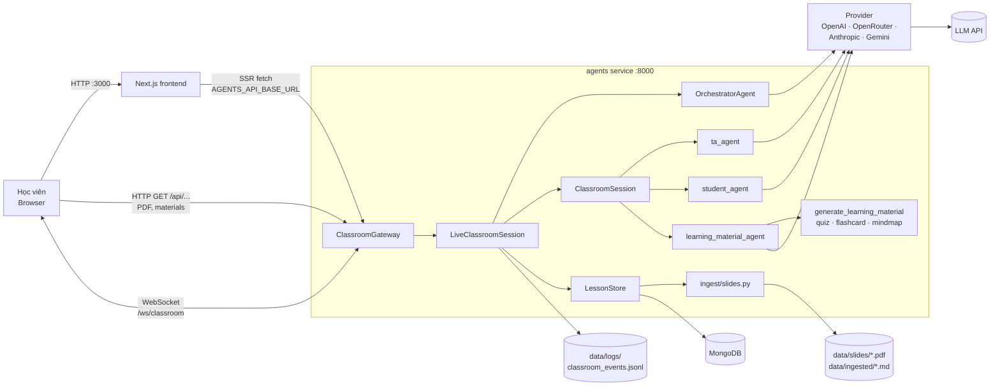
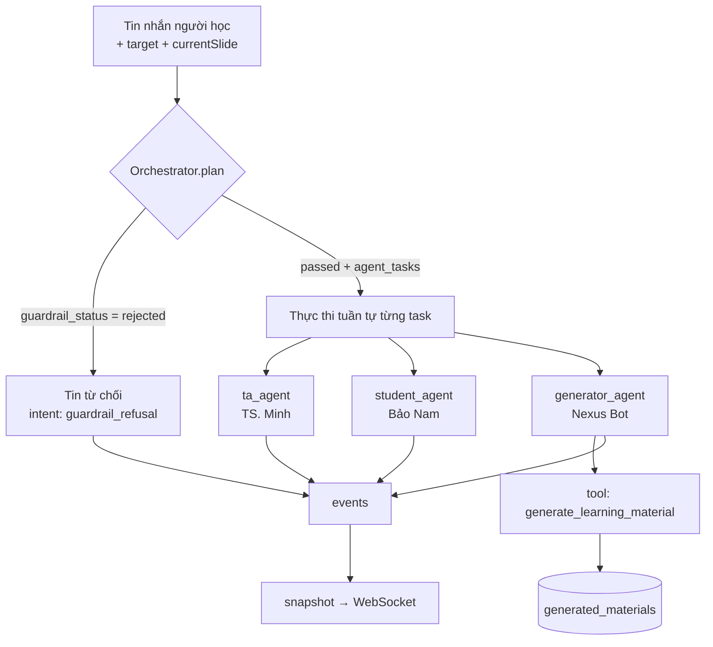
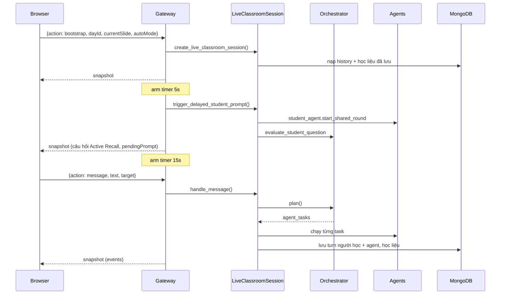

# Kiến trúc hệ thống — Multi-Agent Classroom

Tài liệu mô tả **hiện trạng** kiến trúc của prototype trong `codebase/`. Yêu cầu sản phẩm xem ở [`product-requirements.md`](product-requirements.md). Luồng xử lý một tin nhắn ở mức function xem ở [`codebase/docs/classroom_flow.md`](../codebase/docs/classroom_flow.md).

---

## 1. Tổng quan

Hệ thống gồm 3 service chạy bằng Docker Compose (`codebase/docker-compose.yml`):

| Service | Công nghệ | Cổng | Vai trò |
| --- | --- | --- | --- |
| `frontend` | Next.js 15, React 19, TypeScript, Tailwind CSS, `pdfjs-dist` | 3000 | Giao diện xem slide, chat với agent, thư viện học liệu |
| `agents` | Python 3.12, `websockets`, SDK OpenAI/Anthropic/Google GenAI, `pymongo` | 8000 | Gateway HTTP + WebSocket, điều phối agent, gọi LLM, ingest slide |
| `mongo` | MongoDB 7 | 27018 (host) → 27017 | Lưu bài học, lịch sử hội thoại, học liệu đã sinh |



---

## 2. Frontend (`codebase/frontend`)

### 2.1 Cấu trúc

| Thư mục | Nội dung |
| --- | --- |
| `app/page.tsx` | Route `/`: `LessonView`, xem slide theo bài và checkpoint |
| `app/classroom/page.tsx` | Route `/classroom`: `ClassroomView`, slide + chat đa agent |
| `app/materials/page.tsx` | Route `/materials`: `MaterialsView`, thư viện học liệu |
| `app/api/slides/[dayId]/route.ts` | Phục vụ PDF slide đọc trực tiếp từ `../agents/data/slides/` |
| `app/api/classroom/route.ts` | Endpoint cũ, luôn trả `410 Gone` (đã chuyển sang WebSocket) |
| `components/classroom/` | `ClassroomView`, `ChatStream`, `ChatComposer`, `AgentSidebar`, `ArtifactsSidebar`, `ChatHistoryDrawer`, `LearningViewer`, `AgentProfileModal` |
| `components/artifacts/` | `QuizPanel`, `FlashcardPanel`, `MindmapPanel` |
| `components/lesson/` | `LessonView`, `PdfSlideStage`, `LessonSidebar`, `SlideFooterNav`, `CheckpointModal` |
| `hooks/useClassroomChat.ts` | Quản lý kết nối WebSocket, gửi action, áp snapshot vào state |
| `lib/agents-api.ts` | Gọi HTTP API của agents (server-side và browser) |
| `lib/types.ts` | Kiểu dữ liệu dùng chung (`ClassroomSessionSnapshot`, `ClassroomAgentEvent`, `GeneratedArtifact`, …) |
| `lib/mock-data.ts` | Dữ liệu tĩnh: hồ sơ persona agent, checkpoint theo bài |

### 2.2 Luồng dữ liệu

- **Server-side render:** các page gọi `fetchLectureDays()` (`lib/agents-api.ts`) tới `AGENTS_API_BASE_URL` để lấy danh sách bài học. Lỗi thì dùng `fallbackLectureDays` trong `lib/lecture-data.ts`.
- **Realtime:** `useClassroomChat` mở WebSocket tới `NEXT_PUBLIC_AGENTS_WS_URL`. Khi nhận `kind: "snapshot"`, `applySnapshot()` chuyển `events` thành `Message` và cập nhật state, sau đó `ChatStream` render lại.
- **Optimistic UI:** tin nhắn của người học hiện ngay trên UI trước khi server trả lời.

### 2.3 Biến môi trường

| Biến | Mặc định | Dùng ở |
| --- | --- | --- |
| `AGENTS_API_BASE_URL` | `http://127.0.0.1:8000` | Fetch phía server (trong Docker: `http://agents:8000`) |
| `NEXT_PUBLIC_AGENTS_API_BASE_URL` | `http://localhost:8000` | Fetch phía browser |
| `NEXT_PUBLIC_AGENTS_WS_URL` | `ws://localhost:8000/ws/classroom` | WebSocket |

---

## 3. Backend agents (`codebase/agents`)

### 3.1 Module

| File | Trách nhiệm |
| --- | --- |
| `classroom_gateway.py` | Entry point (`python classroom_gateway.py`). Một server `websockets` vừa trả HTTP GET (qua `process_request`) vừa nhận WebSocket. Quản lý timer bạn học hỏi và timer timeout cho mỗi kết nối. |
| `classroom_runtime.py` | `LiveClassroomSession`: trạng thái một phiên (slide hiện tại, `auto_mode`, `pending_prompt`, history theo kênh, artifacts). Gọi Orchestrator rồi thực thi từng `AgentTask`, ghi Mongo, dựng snapshot. |
| `orchestrator.py` | `OrchestratorAgent`: `plan()` (guardrail + tách ý định + chọn kênh), `evaluate_student_question()` (duyệt câu hỏi của bạn học), `plan_timeout()`, `_heuristic_fallback()` khi JSON lỗi. |
| `classroom_cli.py` | `LectureDeck` (parse Markdown theo heading `## Slide N — Title`), `ClassroomSession` (khởi tạo 3 agent, dựng prompt, chạy JSON agent, tool loop). Cũng là CLI chạy lớp học trên terminal. |
| `agent.py` | `Agent`: bọc system prompt + tools + model; `run()` và `run_loop()` cho function calling. |
| `providers/` | `make_provider(name)` trả về `OpenAIProvider`, `OpenRouterProvider`, `AnthropicProvider` hoặc `GeminiProvider`, cùng interface `complete()` (`providers/base.py`). |
| `tools/` | Registry `TOOL_FUNCTIONS`. Classroom dùng `generate_learning_material` (quiz/flashcard/mindmap). `clarify`, `search_device_info` là di sản từ lab helpdesk. |
| `lesson_store.py` | `LessonStore`: kết nối Mongo, seed bài học từ `LESSON_CATALOG`, CRUD hội thoại và học liệu, tạo index. |
| `ingest/slides.py` | PDF → Markdown bằng `pdftotext` (poppler), fallback `docling`; PPTX qua `docling` + speaker notes. Cache tại `data/ingested/`. |
| `classroom_logging.py` | `ClassroomLogger`: ghi sự kiện JSONL có khoá ghi (thread-safe). |
| `env_loader.py` | Nạp `.env`. |
| `classroom_api.py` | Cầu nối cũ qua stdin/stdout cho route HTTP đã ngưng dùng. |
| `artifacts/system_prompts/` | Prompt cho `orchestrator_agent`, `ta_agent`, `student_agent`, `learning_material_generator`. |
| `artifacts/tools/generate_learning_material.yaml` | Khai báo function-calling cho generator. |

### 3.2 Mô hình agent



**Hợp đồng `OrchestratorPlan`:**

| Trường | Giá trị |
| --- | --- |
| `guardrail_status` | `passed` \| `rejected` |
| `refusal_reason` | lý do khi `rejected`, ngược lại `null` |
| `reply` | lời từ chối (tiếng Việt) hoặc `null` |
| `reasoning` | giải thích nội bộ |
| `agent_tasks[]` | `{agent_name: ta_agent\|student_agent\|generator_agent, channel: shared\|private_ta\|private_student\|material, instruction, reply_to_id}` |

Plan `passed` mà không có task thì runtime tự thêm một task cho `ta_agent`.

**Ngữ cảnh gửi cho agent:** thông tin slide hiện tại (số, tiêu đề, nội dung), `covered_content` (các slide từ 1 tới slide hiện tại), lịch sử kênh (Orchestrator lấy 10 turn gần nhất), `pending_prompt`. Prompt tách khối "Trusted classroom state" khỏi "User input" để giảm rủi ro prompt injection.

**Model:** mặc định theo provider (OpenAI: `gpt-4o-mini`). TA dùng `gpt-4o` với OpenAI/OpenRouter (`_resolve_ta_model`). Ghi đè bằng `CLASSROOM_TA_MODEL`, `CLASSROOM_ORCHESTRATOR_MODEL`, hoặc trường `model` trong action `bootstrap`.

### 3.3 Chế độ tự động (`autoMode`) và timer

| `autoMode` | Khi vào/đổi slide | Sau `CLASSROOM_STUDENT_DELAY_SECONDS` (5s) | Sau `CLASSROOM_ANSWER_TIMEOUT_SECONDS` (15s) không trả lời |
| --- | --- | --- | --- |
| `all` | — | Bạn học hỏi trên kênh `shared` (Orchestrator duyệt câu hỏi) | `plan_timeout` → TA trả lời mẫu |
| `student` | — | Bạn học hỏi trên kênh `private_student` | như trên |
| `teacher` | TA tóm tắt slide ngay trên `private_ta` | — | — |
| `generator` | — | — | — |

Mỗi request mới tăng `state_token` và huỷ mọi timer đang chờ. Khi timer kích hoạt, nó kiểm tra lại token, slide và câu hỏi đang chờ để tránh gửi phản hồi cũ.



---

## 4. Giao thức

### 4.1 HTTP (cổng 8000, chỉ GET, CORS `*`)

| Endpoint | Trả về |
| --- | --- |
| `GET /health` | `{ok, service}`; kiểm tra Mongo sẵn sàng |
| `GET /api/artifacts` | Danh sách bài học |
| `GET /api/artifacts/{id}` | Metadata bài học + nội dung đã ingest |
| `GET /api/artifacts/{id}/file` | File PDF slide (`Cache-Control: max-age=3600`) |
| `GET /api/artifacts/{id}/materials?type=quiz\|flashcard\|mindmap` | Học liệu đã sinh |
| `GET /api/artifacts/{id}/conversations` | Tóm tắt các cuộc hội thoại (tối đa 50) |
| `GET /api/materials/{materialId}` | Một học liệu |

Mã lỗi: `404` (không tìm thấy, `ValueError`/`FileNotFoundError`), `503` (`RuntimeError`, ví dụ Mongo chưa sẵn sàng), `500` (lỗi khác).

### 4.2 WebSocket `/ws/classroom`

**Client → server** (JSON, `max_size` 2 MB):

| `action` | Trường |
| --- | --- |
| `bootstrap` | `dayId`, `currentSlide`, `autoMode`, tuỳ chọn `provider`, `model`, `source`, `request_id` |
| `sync_slide` | `currentSlide`, `autoMode` |
| `message` | `text` (bắt buộc), `target` (`all`\|`teacher`\|`student`\|`generator`), `currentSlide`, tuỳ chọn `message_id`, `reply_to_id` |

**Server → client:**

```jsonc
{ "kind": "snapshot", "request_id": "…", "snapshot": {
    "sessionId": "ws-…", "dayId": "day1",
    "currentSlide": 5, "currentSlideTitle": "…", "maxSlide": 40,
    "pendingPrompt": { "mode": "shared|student", "question": "…" } | null,
    "artifacts": { /* quiz / flashcard / mindmap của phiên */ },
    "historyTopics": ["…"], "materialsCount": 3,
    "events": [{
      "id": "msg_ab12cd34", "kind": "message",
      "agent": "teacher|student|generator",
      "channel": "shared|private_ta|private_student|material",
      "intent": "…", "reply": "…", "citations": ["slide 5"],
      "active_recall": false, "reply_to_id": "msg_…" }]
}}
{ "kind": "error", "request_id": "…", "message": "…" }
```

Snapshot chỉ chứa **event mới** của request đó, không gửi lại toàn bộ lịch sử.

---

## 5. Dữ liệu

### 5.1 MongoDB — database `multi_agent_classroom`

| Collection | Khoá / index | Nội dung |
| --- | --- | --- |
| `artifacts` | `id` (unique) | Bài học: `name`, `url`, `metadata.{artifact_type, source_file, markdown_file, slide_count, transcripts[]}` |
| `ingested_artifacts` | `artifact_id` (unique) | Markdown đã ingest, `important_timestamp[]` (marker theo slide) |
| `conversation_histories` | `id` = `{session_id}:{scope}` (unique); `(artifact_id, updated_at desc)` | `scope`, `topic`, `message_count`, `turns[] {id, timestamp, actor, intent, message, citations, slide_number, slide_title, reply_to_id}` |
| `generated_materials` | `id` = `mat-{uuid}` (unique); `(artifact_id, created_at desc)`; `(artifact_id, material_type)` | `material_type`, `title`, `content_format`, `content`, `item_count`, `citations`, `covered_until`, `slide_number`, `session_id` |

**Seed:** `LessonStore._ensure_seed_data()` upsert các bài trong `LESSON_CATALOG` (`day1` — AI & LLM Foundation, `day2` — Xác định bài toán cho AI) ở lần dùng đầu tiên. Bước này ingest PDF nếu chưa có cache Markdown.

### 5.2 File system (`codebase/agents/data/`, gitignore)

| Đường dẫn | Nội dung |
| --- | --- |
| `slides/*.pdf` | Slide gốc (`d1-slide-hackathon.pdf`, `d2-slide-hackathon.pdf`) |
| `ingested/*.md` | Markdown sau ingest, mỗi slide là một heading `## Slide N — Title` |
| `logs/classroom_events.jsonl` | Log sự kiện: `session_started`, `slide_changed`, `mode_changed`, `learner_timeout`, `orchestrator_student_critique`, `session_closed`, `request_failed`, … |

---

## 6. Triển khai & cấu hình

### 6.1 Docker Compose

`docker-compose.yml` ở root `include` file `codebase/docker-compose.yml`. Lệnh chạy service `agents`: `python classroom_gateway.py`. Mount source dạng volume để hot-reload khi dev. Build arg `INSTALL_DOCLING=true` cài thêm `docling` (mặc định tắt để image nhẹ; image luôn có `poppler-utils`).

Chạy không dùng Docker: xem [`INSTALLATION_GUIDE.md`](../INSTALLATION_GUIDE.md). Entry point backend: `python classroom_gateway.py`.

### 6.2 Biến môi trường backend (`codebase/agents/.env`)

| Biến | Mặc định | Ý nghĩa |
| --- | --- | --- |
| `CLASSROOM_PROVIDER` | `openai` | `openai` \| `openrouter` \| `anthropic` \| `gemini` |
| `OPENAI_API_KEY` / `OPENROUTER_API_KEY` / `ANTHROPIC_API_KEY` / `GEMINI_API_KEY` | — | Khoá của provider đã chọn (bắt buộc với provider đó) |
| `OPENROUTER_BASE_URL` | `https://openrouter.ai/api/v1` | |
| `CLASSROOM_TA_MODEL` | theo provider | Model riêng cho TA |
| `CLASSROOM_ORCHESTRATOR_MODEL` | theo provider | Model riêng cho Orchestrator |
| `CLASSROOM_API_HOST` / `CLASSROOM_API_PORT` | `0.0.0.0` / `8000` | |
| `CLASSROOM_STUDENT_DELAY_SECONDS` | `5` | Chờ trước khi bạn học hỏi |
| `CLASSROOM_ANSWER_TIMEOUT_SECONDS` | `15` | Chờ người học trả lời |
| `CLASSROOM_MONGODB_URI` (hoặc `MONGODB_URI`) | `mongodb://localhost:27017` | |
| `CLASSROOM_MONGODB_DB` | `multi_agent_classroom` | |

---

## 7. Đặc tính kỹ thuật và hạn chế đã biết

- **Xử lý đồng bộ:** `handle_message()` và các lời gọi LLM là hàm sync chạy trong coroutine của `websockets`. Trong lúc một lượt đang gọi LLM, event loop bị chặn, nên các kết nối khác và timer cũng phải chờ.
- **Trạng thái phiên trong bộ nhớ:** `LiveClassroomSession` sống theo kết nối WebSocket. Mất kết nối thì phải `bootstrap` lại (history và học liệu nạp lại từ Mongo). Chỉ chạy được một instance, không scale ngang.
- **Không có auth / rate limit**, CORS `*`.
- **Danh mục bài học khai báo ở hai nơi:** `LESSON_CATALOG` (`lesson_store.py`) và `SLIDE_FILES` (`frontend/app/api/slides/[dayId]/route.ts`).
- **`websockets` không có trong `requirements.txt`**, chỉ có mặt nhờ được cài gián tiếp (nhiều khả năng qua `google-genai`).
- **Chưa có test tự động** cho backend/frontend. Chất lượng được đo bằng golden set thủ công trong `eval/`.
